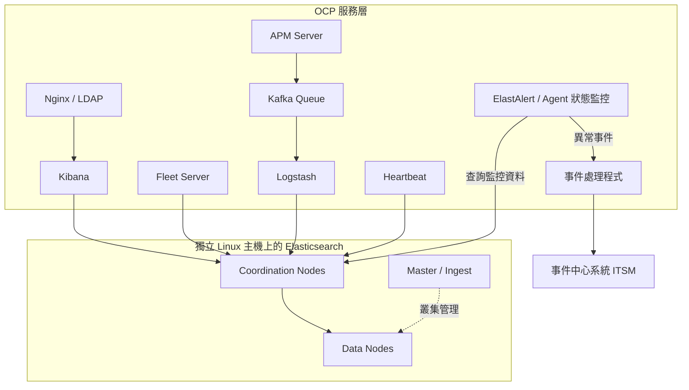
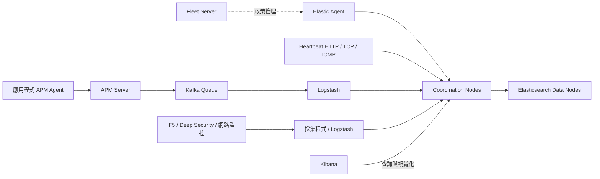
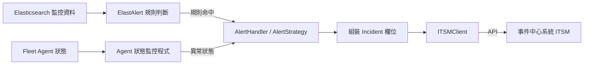

# Elasticsearch Observability Platform

我獨立完成這套 Production Elasticsearch 監控平台的架構設計、部署、資料採集、生命週期管理、存取控制、告警整合與日常維運。我將日誌、系統指標、服務可用性與 APM 資料集中管理，並透過 **event driven** 的告警流程，將異常送入**事件中心系統(ITSM)**，銜接後續處理。

我在這裡公開原始 workspace 的去識別化程式碼、告警規則與部署設定，讓每個架構決策都能對照到實作。

## 我如何決定 Production 部署位置

我評估既有 Production OCP 的共用運算資源與儲存條件後，選擇將 Elasticsearch 部署在獨立 Linux 主機。持續寫入、segment merge、shard recovery 與大量查詢都會競爭磁碟 I/O；我需要能獨立控制資料層的吞吐量、延遲、容量與資源配置。

我將 Kibana、Fleet Server、APM Server、Heartbeat、Logstash、Nginx／LDAP 與告警服務配置在 OCP 服務層。我依各元件的寫入量、持久化需求與故障影響安排資源，將高 I/O 的 Elasticsearch 資料層與服務層分開管理。

我以工作負載與儲存實測作為部署依據。Elastic 的 Kubernetes 儲存建議指出，local storage 與 network-attached storage 的效能需要依 Elasticsearch 使用情境評估；這也是我判斷既有 OCP 儲存是否適合承載資料節點的依據。[Elastic 儲存建議](https://www.elastic.co/docs/deploy-manage/deploy/cloud-on-k8s/storage-recommendations)



## 我如何分工 Elasticsearch 節點與資料生命週期

我透過 Master 管理叢集狀態與 shard 配置，透過 Ingest 處理寫入前的資料轉換。我使用 Coordination Nodes 接收查詢與寫入請求、分派工作並彙整結果，再由 Data Nodes 負責索引、搜尋與儲存。

我以 **Hot／Cold** 管理資料生命週期：我在 Hot 階段承接持續寫入與近期查詢，透過 ILM 控制 rollover，再依資料用途與保留需求進入 Cold，最後執行到期刪除。我依資料種類配置保留政策，讓查詢需求與儲存容量一起納入維運。

我把原本部署在 OCP 的 Elasticsearch 設定保留於 [Elasticsearch 原部署檔](manifests/elasticsearch-legacy/)。其中 `ES-*.yaml.disabled` 就是原 ES 元件；我保留這些檔案、相關 ConfigMap、Service、PV 與 PVC，呈現原本的節點配置與部署關係。

## 我如何收集與呈現監控資料

我使用 Fleet 管理 Elastic Agent 的註冊、政策與整合設定，讓各主機的資料採集有一致的管理入口。我將 Fleet 的政策管理與 Agent 的資料寫入分開理解：Agent 依政策向設定的 output 傳送資料。

我透過 Heartbeat 進行 HTTP、TCP 與 ICMP 探測，保留排程、逾時、預期回應與探測方式。我透過 APM 收集應用程式的交易、錯誤與追蹤資料，再由 Kafka 承接寫入、Logstash 消費與轉送，寫入 Elasticsearch。



我在 Kafka 部署中配置三個 broker/controller、三份複本與至少兩份同步複本，透過持久化儲存與 Logstash consumer 管理 APM 的資料傳遞。我在 Kibana 集中查看日誌、指標、可用性與 APM，從異常現象追查到對應主機或應用程式。

| 元件 | 我的實作重點 | 程式與設定 |
| --- | --- | --- |
| Kibana | 我提供監控查詢、視覺化與權限管理入口。 | [Kibana 設定](components/kibana/CM-kbn1/kibana.yml)、[部署檔](manifests/kibana/) |
| Fleet／Elastic Agent | 我集中管理 Agent，並配置 Fleet Server 的服務、憑證與連線設定。 | [Fleet 設定](components/fleet/)、[部署檔](manifests/fleet/) |
| APM／Kafka／Logstash | 我建立 APM → Kafka → Logstash → Elasticsearch 的資料路徑。 | [APM 設定](components/apm-kafka/CM-apm-2kafka/apm-server.yml)、[Logstash pipeline](components/apm-kafka/CM-logstash-kafka-apm/logstash.conf)、[Kafka 部署](manifests/apm-kafka/ES-kafka.yaml) |
| Heartbeat | 我用 HTTP、TCP 與 ICMP 檢查服務和主機的可用性。 | [探測設定](components/heartbeat/)、[部署檔](manifests/heartbeat/) |
| 網路監控 | 我用 Logstash 接收並處理網路監控事件。 | [Logstash pipeline](components/logstash/CM-nms_ls_pipeline/logstash.conf) |
| F5 | 我採集 pool、member、可用狀態與連線數。 | [Python 採集程式](components/f5-metric-collection/f5_collection.py) |
| Deep Security | 我採集 Agent 狀態、惡意程式、完整性與入侵防護事件。 | [Agent 狀態採集](components/security/DS_Agent_Status.pl)、[事件採集](components/security/DS_Event_Alert.pl)、[排程部署](manifests/security/) |
| vSphere | 我配置 Elastic Agent 的虛擬化環境整合。 | [部署檔](manifests/vsphere/ES-vSphere-integration.yaml) |

## 我如何整合 LDAP 認證與 Kibana 授權

我在 Nginx 加入 LDAP 認證功能，透過 `auth_request` 呼叫 LDAP 認證服務。我先由 LDAP 確認登入身分，通過後才讓請求進入 Kibana。

我讓 **LDAP 負責認證，Kibana 負責授權**。我在代理入口設定對應的後端授權身分，並以 Kibana 與 Elasticsearch 的角色權限控制可操作功能及資料範圍。我將 LDAP bind 設定、後端授權資料與實際連線位置保存在 repository 外。

我保留 [Nginx 設定](components/access/CM-nginx1/nginx.conf)、[LDAP 認證程式](components/access/CM-python-ldap/nginx-ldap-auth-daemon.py) 與 [部署關係](manifests/access/)，呈現登入入口、認證子請求及後端代理如何串接。

## 我如何以 Event driven 串接告警與事件中心

我以異常事件驅動後續處理。我透過 ElastAlert 的查詢條件、門檻、事件次數與時間窗辨識異常；規則命中後，我將事件交給對應的處理策略，組裝 Incident，再呼叫事件中心系統(ITSM) API。

我讓告警程式處理不同來源的差異：CPU、記憶體、磁碟、服務可用性、應用日誌、APM、安全事件與網路設備，各自有對應的參數解析、事件標題與描述欄位。我另外定期查詢 Fleet Agent 狀態，將異常 Agent 交給相同的事件處理流程。



我保留 [76 個原始告警規則](components/alerting/CM-Alert-condition/)、[事件處理策略與 ITSMClient](components/alerting/CM-Alert-poster/ticket_creater.py)、[Agent 狀態監控](components/alerting/CM-Alert-elastic_agent/elastic_agent_monitor.py)，以及 [獨立 Agent 告警程式](components/elastic-agent-alert/)。我保留規則中的判斷結構、時間窗與參數位置，將實際目標及業務條件改由外部設定提供。

## 我如何整理這份原始碼

我將原始 workspace 的 105 個程式與設定來源整理到以下位置，並把 ConfigMap 裡的程式及設定拆成獨立檔案，方便閱讀與維護。

```text
components/                 我的程式、告警規則與服務設定
  access/                   Nginx、LDAP 與入口頁
  alerting/                 ElastAlert、事件處理策略與 Agent 狀態監控
  elastic-agent-alert/      獨立 Agent 告警程式與 Dockerfile
  apm-kafka/                APM 與 Logstash Kafka pipeline
  elasticsearch-legacy/     原 ES 節點設定
  fleet/                    Fleet Server 設定與憑證欄位
  heartbeat/                HTTP、TCP、ICMP 探測設定
  kibana/                   Kibana 設定
  logstash/                 網路監控 pipeline
  f5-metric-collection/      F5 採集程式
  security/                 Deep Security 採集程式
manifests/                  依元件分類的 OCP 部署與儲存設定
config/                     外部參數目錄與 ConfigMap 檔案對應
tools/                      只處理本機檔案的組裝與靜態檢查工具
docs/                       元件導覽、設定方式與來源清單
```

我在 [元件導覽](docs/components.md) 說明各檔案的角色，在 [來源清單](docs/source-inventory.json) 保留原始檔與公開檔案的對應。我將環境專屬設定改成 `__CFG_0001__` 形式的參數，透過 [設定整理方式](docs/configuration.md) 在 repository 外還原完整設定檔。

我以 [靜態檢查](docs/validation.md) 核對語法、設定對應與公開內容。
