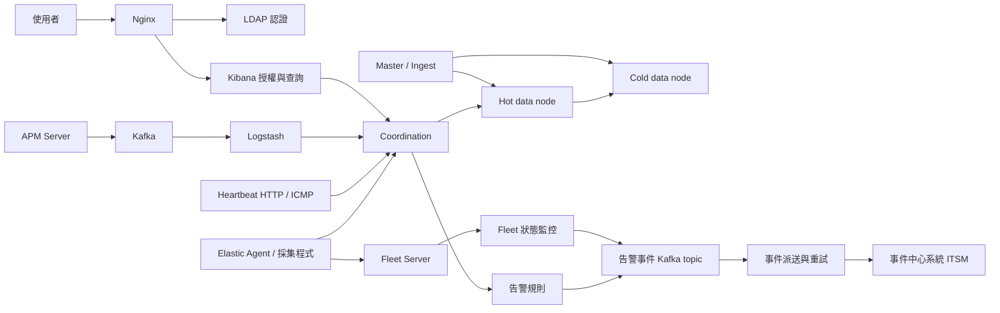

# Observability Platform

我獨立完成這套 Elasticsearch 監控平台的架構設計、部署、資料生命週期、LDAP 整合、Fleet 管理、APM 與 Kafka 串接、告警、事件中心整合及日常維運。我用同一套平台串起基礎設施狀態、應用程式日誌、可用性探測與交易追蹤，讓異常能從監控資料一路轉成可處理的事件。

我將部署設定、初始化程式、採集服務、告警規則與事件派送程式整理在這個專案。所有服務位址與機敏設定都由執行時產生，或由 repository 外的設定檔提供。

## 我的部署選擇

我不把 Elasticsearch 的高 I/O data node 放在既有 Production OCP 的共用資源與儲存環境。持續寫入、segment merge、shard recovery 與查詢都會使用大量磁碟 I/O；我將資料節點放到獨立 Linux 主機，讓磁碟吞吐量、延遲、容量與資源配置更容易控制。我把 Kibana、Fleet、APM、採集與事件處理服務留在可容器化的服務層。

我依據實際儲存條件決定部署位置。Elastic 將 local SSD 的效能、網路磁碟的差異及儲存實測列為 Kubernetes 的評估重點；Red Hat 也明列其 Elasticsearch logging 儲存不支援 NFS。我據此採用獨立資料層，並未把所有 Kubernetes／OCP 部署都視為不可行。參考 [Elastic 儲存建議](https://www.elastic.co/docs/deploy-manage/deploy/cloud-on-k8s/storage-recommendations)、[Red Hat Elasticsearch 儲存說明](https://docs.redhat.com/en/documentation/openshift_container_platform/4.9/html/logging/configuring-your-logging-deployment)。



## 我的元件與資料路徑

| 元件 | 我的設計與實作 | 專案位置 |
| --- | --- | --- |
| Elasticsearch | 我分開 master／ingest、coordination、Hot、Cold 的工作，避免資料寫入與查詢協調互相干擾。 | `config/elasticsearch.yml`、`compose.yaml` |
| Hot／Cold 與 ILM | 我在 Hot 處理持續寫入與近期查詢，再由 ILM 將資料移往 Cold，最後依保留時間刪除。 | `config/ilm-hot-cold.json` |
| Kibana | 我集中呈現日誌、指標、APM、可用性與 Fleet 狀態，並使用角色與 Spaces 控制存取。 | `config/kibana.yml`、`scripts/bootstrap.py` |
| Nginx／LDAP | 我讓 Nginx 透過 `auth_request` 串接 LDAP 認證服務，再把個人身分交給 Kibana 進行授權。 | `config/nginx.conf.template`、`monitoring/ldap_auth.py` |
| Fleet Server／Elastic Agent | 我集中管理 Agent 的政策、整合、註冊與狀態，並部署 Fleet 管理的 APM。 | `scripts/bootstrap.py`、`scripts/fleet-start.sh` |
| Kafka | 我用三個 KRaft 節點承接 APM 與告警事件，採三份複本、最少兩份同步複本及完整寫入確認。 | `compose.yaml`、`scripts/kafka-topics.sh` |
| APM／Logstash | 我保留 APM 直接進 Kafka、經 Logstash 寫入 Elasticsearch 的路徑，也保留 Fleet 管理的 APM。 | `config/apm-server.yml`、`config/logstash-apm.conf` |
| Heartbeat | 我用 HTTP 與 ICMP 探測服務與主機，透過可重新載入的監控清單管理目標。 | `config/heartbeat.yml` |
| 網路監控日誌 | 我用 Logstash 的 UDP input 接收網路監控資料，再寫入 data stream。 | `config/logstash-network.conf` |
| 告警規則 | 我保留 76 個規則的頻率、時間窗、查詢與指令處理結構，並把服務與主機條件改成外部參數。 | `config/rule-catalog.json` |
| Event driven 派送 | 我把規則命中與 Agent 異常轉成事件，再由 Kafka consumer 派送至事件中心系統(ITSM)。 | `monitoring/events.py`、`monitoring/worker.py` |
| Fleet 狀態監控 | 我完整讀取分頁中的 Agent，只有異常狀態發生變化時才發送事件。 | `monitoring/fleet_monitor.py` |
| F5 | 我採集 pool、member、狀態及統計資料。 | `monitoring/collectors.py` |
| Deep Security | 我採集 Agent 狀態，並透過資料庫採集惡意程式、完整性與入侵防護事件。 | `monitoring/collectors.py`、`docker/security-collector.Dockerfile` |
| vSphere | 我透過 Fleet 的 vSphere integration 採集虛擬化環境指標。 | `scripts/bootstrap.py`、`compose.yaml` |
| 原 ES 元件 | 我把原 OCP Elasticsearch 部署保留在 `deploy/legacy`，副檔名帶有 `.disabled` 的檔案就是原 ES 元件。 | `deploy/legacy/` |

## 我的認證與授權流程

我在 Nginx 加入 LDAP 認證功能。瀏覽器送出登入資料後，Nginx 先向 LDAP 認證服務確認身分；LDAP 認證成功後，Nginx 才將請求轉交 Kibana。

我讓 LDAP 負責認證，Kibana 負責授權。我保留使用者自己的身分，透過 Kibana 角色、Spaces 與 Elasticsearch 索引權限，決定每位使用者能查詢的資料及可操作的功能。

我在可直接啟動的環境中建立真正的 OpenLDAP directory 與對應的個人 Elasticsearch native identity，讓這個流程能實際運作。我將登入資料放在 repository 外；我也用整合檢查確認唯讀角色可以登入，但不能刪除 dashboard。

## 我的事件驅動告警

我以 **event driven** 作為告警整合的主軸：我把 CPU、記憶體、磁碟、可用性、日誌、APM 與 Agent 異常整理成統一事件，再交給事件中心系統(ITSM)建立 Incident。

我用規則引擎定期查詢監控資料，也用 Fleet 狀態檢查找出 Agent 的狀態變化。事件產生後，我透過 Kafka 分開規則判斷與事件派送，讓事件中心暫時無法回應時，監控側仍能持續記錄事件。

我保留原來告警策略的欄位處理與 Incident 組裝，並加入事件 ID、派送紀錄、重試與 dead letter topic。只有事件中心接受事件後，我才提交 Kafka offset；重送時我沿用相同的冪等鍵。我在事件中心也需要支援冪等鍵，才能處理回應中斷造成的不確定結果。

## 我如何啟動整套服務

我使用 Python 3.12 以上、Docker Engine 與 Docker Compose。整套服務包含四個 Elasticsearch 節點、三個 Kafka 節點與監控服務，我為執行主機準備至少 16 GiB 記憶體，並在 Linux 調整 `vm.max_map_count`。

```bash
python -m pip install -r requirements.txt
sudo sysctl -w vm.max_map_count=1048576
python -m scripts.platform init
python -m scripts.platform config
python -m scripts.platform up
python -m scripts.platform check
python -m scripts.platform login
```

我用 `init` 在使用者的本機資料目錄產生設定、隨機密碼、服務位址與憑證需求；初始化不會覆蓋既有密碼。`up` 會建置程式、建立憑證、初始化 Elasticsearch 權限與 ILM、建立 Kafka topics、安裝 Fleet／APM integration，並啟動採集與告警服務。`login` 只顯示本機登入位置及密碼檔案所在位置。

我用 `check` 實際驗證節點角色、LDAP 登入、Kibana 授權、Heartbeat 寫入、ILM、Agent 註冊，以及 APM 經 Kafka／Logstash 進入 Elasticsearch 的完整路徑。

我用以下命令檢查與停止服務，保留 persistent volumes 中的資料：

```bash
python -m scripts.platform status
python -m scripts.platform down
```

## 我如何接上外部系統

我把事件中心系統(ITSM)、F5、Deep Security、vSphere、LDAP 與監控目標的設定放在 repository 外的 `operator.json`。我用 [外部設定欄位](docs/operator-settings.md) 填入所需資訊，再以 `init --operator` 載入；初始化會依設定啟用對應的 Compose profile。

```bash
python -m scripts.platform init --operator /path/to/private/operator.json
python -m scripts.platform up
```

我在 `config/rule-catalog.json` 保留全部規則。共用的六項門檻與可用性規則會直接啟用；應用程式、網路設備與服務專屬規則由我在外部設定中指定查詢條件與啟用狀態。

## 我的部署與驗證檔案

我用 `compose.yaml` 部署 Linux 主機上的完整服務，也用 [OCP 部署流程](docs/ocp-deployment.md) 產生服務層的 OpenShift manifests。我不在 OCP manifests 中啟用 Elasticsearch data node。

我在 `.github/workflows/verify.yaml` 保留自動化驗證：我先執行程式與設定檢查，再在獨立 runner 啟動真正的容器並驗證完整資料路徑。我不在 CI 或 Git 中保存私有設定、登入資料、正式環境資料或憑證。
